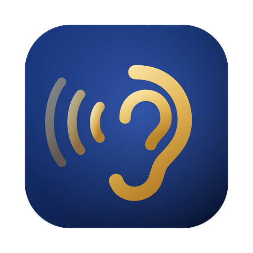
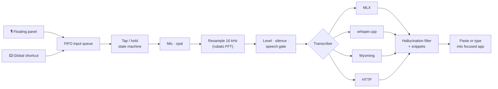

<div align="center">



# Sedjem

**Speak anywhere on your Mac. Text appears where your cursor is.**

A floating, always-on-top microphone that turns your voice into text with a **local Whisper model**
and types it straight into the app you are using. No cloud, no account, no subscription.

[](https://github.com/enverkaradede/sedjem/releases/latest)


[](LICENSE)

*Sedjem (sḏm) — in ancient Egyptian, "to hear". Its hieroglyph is an ear.*

</div>

---

## ✨ Highlights

|  |  |
|---|---|
| 🎙️ **One button, two gestures** | **Tap** to start, tap again to stop. **Hold** to talk, release to finish. Same logic on a global shortcut (default <kbd>⌥</kbd> <kbd>Space</kbd>). |
| 🔒 **Local first** | Whisper large-v3-turbo runs on the Apple GPU. Your voice never leaves the Mac unless you choose a network engine. |
| ⚡ **Fast** | A 4.5 s Turkish sentence transcribed word-perfect in **0.16 s** (MLX, M5 Max, warm model). |
| 🪟 **Never steals focus** | The mic is a non-activating panel above every window and full-screen app; text lands in the app you were already typing in. |
| 🧩 **Swappable engines** | MLX, embedded whisper.cpp, Wyoming (e.g. a home server) or any OpenAI-compatible endpoint, all behind one interface. Ready for streaming models. |
| ✂️ **Voice snippets** | Say "my signature" and get your full email signature. Exact or inline matching, per snippet. |
| 🔄 **Self-updating** | Signed updates from GitHub Releases, verified against a key built into the app. |
| 🎨 **Crafted** | Lapis-and-gold design, a voice-reactive aura, spring animations, and zero CPU use while idle. |

## 🚀 Install

1. Download **`Sedjem_x.y.z_aarch64.dmg`** from the [latest release](https://github.com/enverkaradede/sedjem/releases/latest) and drag Sedjem to **Applications**.
2. **First launch:** Sedjem is signed with a self-signed certificate, not notarized by Apple, so Gatekeeper
   will warn you. Right-click the app → **Open**, or run:
   ```bash
   xattr -dr com.apple.quarantine /Applications/Sedjem.app
   ```
3. Grant two permissions when asked (or from **Settings → İzinler**):
   - **Microphone**, to hear you.
   - **Accessibility**, to paste the text into the focused app.
4. Pick an engine in **Settings → Motor & Model**. If you already have
   `mlx-community/whisper-large-v3-turbo` in your Hugging Face cache, Sedjem finds it automatically and can
   set up its own isolated Python runtime with one click. Otherwise download a whisper.cpp model in-app.

> The interface is currently in Turkish 🇹🇷. Dictation works in any language Whisper supports
> (auto-detected or pinned).

## 🎛️ Using it

| Gesture | Button | Shortcut | What happens |
|---|---|---|---|
| **Tap** | click | press & release quickly | Recording starts (🔒 badge). Tap again to finish. |
| **Hold** | press and hold | hold the keys | Records while held; release to finish. |
| **Cancel** | hover → ✕ | | Discards the recording. |
| **Move** | drag the ⋯ grip | | Position is remembered across launches. |

Text is inserted by **paste** (clipboard + <kbd>⌘</kbd><kbd>V</kbd>, your previous clipboard is restored and
marked transient for clipboard managers) or by **typing it directly** (Unicode key events, the clipboard
is never touched). Optional **auto-Enter** sends the message for you in chats and terminals.

## 🧠 Engines

| Engine | Runs on | Best for |
|---|---|---|
| **Local MLX** | Apple GPU, warm Python worker | Fastest on Apple Silicon; reuses models you already have |
| **Embedded whisper.cpp** | Metal, inside the app | No Python at all; pinned, SHA-256-verified model downloads |
| **Wyoming** | a server on your LAN | Offload to a home server (e.g. faster-whisper) |
| **OpenAI-compatible HTTP** | any `/v1/audio/transcriptions` | whisper.cpp server, mlx-audio, speaches… (HTTPS required for remote hosts; key kept in Keychain) |

## 🏛️ How it works



- **Pure controller.** Tap vs hold is decided on release, so recording starts with zero added latency.
- **Whisper's ghosts filtered.** Silence never reaches the model, and known hallucinations
  ("Altyazı M.K.", "Thanks for watching") are dropped.
- **Streaming-ready.** Audio already flows to the engine chunk by chunk. A streaming model only needs to
  implement two methods:

  ```rust
  impl Transcriber for MyStreamingEngine {
      fn supports_streaming(&self) -> bool { true }
      fn open_stream(&self, opts: &TranscribeOptions) -> Result<Box<dyn StreamingSession>, EngineError> { … }
      // …
  }
  ```

  Partial text is forwarded to the UI as it arrives. No change to capture, controller or UI flow.

## 🛡️ Privacy & security

- Transcripts are **never logged** (only lengths and timings). History lives in memory only, never on disk.
- API keys go to the **macOS Keychain**, never to `settings.json`.
- Plain HTTP is refused for non-local hosts.
- Model downloads are pinned to a commit and **SHA-256 verified**; updates are **minisign-verified**.
- Least-privilege Tauri capabilities per window and a strict CSP.

## 🛠️ Development

Requirements: macOS 13+ on Apple Silicon, Rust (stable), Node 20+, pnpm, Xcode command-line tools, CMake.

```bash
pnpm install
pnpm tauri dev                                         # run with hot reload

cd src-tauri && cargo test && cargo clippy --all-targets -- -D warnings
pnpm typecheck && pnpm test
```

```
src/                    React + Tailwind UI (panel & settings windows)
src-tauri/src/
  controller.rs         tap/hold state machine (pure, tested)
  dictation.rs          press → record → transcribe → insert orchestration
  audio/                capture, resampling, level & silence detection
  engine/               Transcriber trait + MLX, whisper.cpp, Wyoming, HTTP adapters
  text.rs               hallucination filter & snippet expansion
  platform/             macOS paste/typing, permissions, Keychain
  updates.rs            signed self-update
scripts/release.sh      build · sign · publish a release
```

### Releasing

```bash
scripts/release.sh 0.2.0 notes.md
```

The script bumps the version, runs every test, builds and code-signs the app, signs the update archive,
writes `latest.json`, tags the commit and publishes the GitHub release. Installed copies pick up the update
on their next check. Releases are built locally on purpose: a stable code signature keeps users'
macOS permissions across updates.

## 📜 License

[MIT](LICENSE) © 2026 Enver Karadede

<div align="center"><sub>Made with care for people who think faster than they type.</sub></div>
